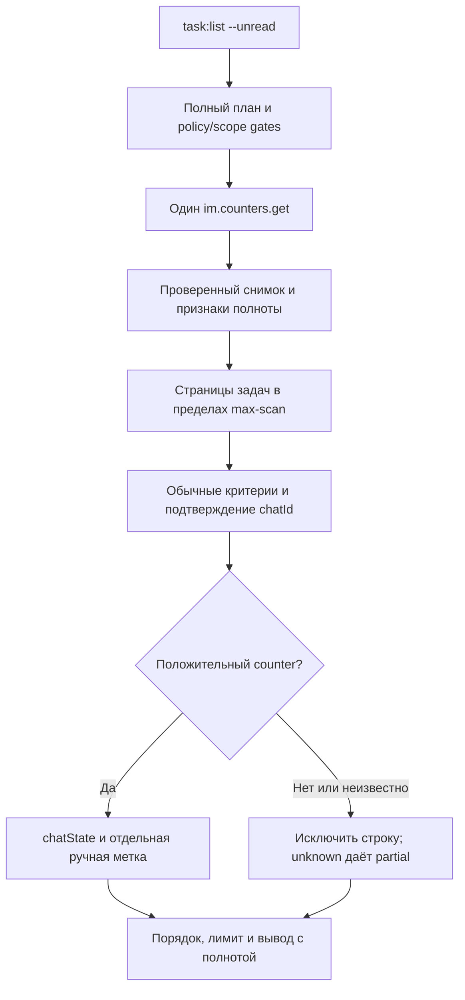

# Design

## Context

Мотивация и объём приведены в [proposal.md](proposal.md), проверенные наблюдения — в [research.md](research.md). База проектирования — `dev` на `6eb4673e16ca21fcd242c3f9b1b987dc82716752`; реализация выполнена на `dev` `ff9481e` (после #183/#186/#202/#208), уточнения — в разделе «Реализация» ниже.

`TaskListScanner` уже выполняет ограниченный обход, локальные предикаты, проверку роли/группы, стабильный порядок и только затем лимит вывода. Обычный список читает REST3 `tasks.task.list`; temporal-режим использует явно выбранный REST1 `Rest1TaskListAdapter`. Последний пока не поддерживает `CHAT_ID`. `TaskQuery` и `TaskInputMapper` используются также другими командами, поэтому общий парсер не должен незаметно расширять их интерфейс.

`TaskChatAdapter` получает `im.dialog.messages.get`, но при нормализации теряет `unread`. `ChatSupport` уже проверяет связь задачи с чатом, ограничивает окно сообщений и сообщает неполноту. `ResultPresenter` имеет фиксированные TSV-колонки; добавление поля в JSON само по себе не обеспечивает корректный human-вывод. `CommandCatalog`, policy guard и `ScopeManifest` определяют разрешённые маршруты до API-вызовов.

На проверенном портале `TASKS_TASK`/`TASKS_TASK_UNREAD` доступны, но отсутствуют в проверенной публичной таблице ответа `im.counters.get`. Поддержка схемы должна быть явной и проверяемой. Результаты одного портала с двумя администраторами не доказывают совместимость всех порталов и ролей.

## Goals / Non-Goals

**Goals:**

- Встроить дополнительный предикат до существующего лимита, сохранив единую реализацию обхода и его диагностику.
- Изолировать неполностью документированный wire-контракт в IM-адаптере и тестовых фикстурах; приложение получает типизированный снимок с отдельной полнотой счётчиков и ручных меток.
- Сохранить источник и время наблюдения, стоимость запросов и причины неизвестного состояния доступными для проверки.

**Non-Goals:**

- Новый task API field, изменение серверных фильтров и сортировка по производным полям `chatState`.
- Постоянное хранилище read position, синхронизация событий или атомарный снимок задач и сообщений. Остальные границы продукта описаны в proposal.

## Decisions

### 1. Один снимок IM и соединение со стороны задач

Добавить порт чтения снимка счётчиков и REST1-адаптер `im.counters.get`. Передать запрос на unread явно из `ListTaskCommand` через request/query в `ListTasksHandler` и scanner; для `find`/`my` значение остаётся выключенным. DI регистрирует адаптер, но обычный список его не вызывает.

Порядок выполнения: offline validation → выбор полного плана маршрутов → policy/scope gates → один снимок счётчиков → существующий обход задач → обычные критерии → подтверждение `chatId` → unread-предикат → общий лимит/вывод. Снимок создаётся на запуск, без общего или постоянного кэша. Прерывание проверяется перед каждым запросом и в циклах.

Предлагаемый поток; все запросы в нём читают данные:



Scanner запрашивает `chatId` только при включённом флаге. Скалярный положительный `chatId`, возвращённый task API для конкретной строки, подтверждает связь. Для temporal route добавить явное отображение `CHAT_ID` и нормализацию ID без добавления поля в базовый select обычного списка. Если scalar отсутствует или повреждён, после обычных критериев разрешено одно ограниченное `tasks.task.get` выбранной задачи с `chat.id/entityId/entityType`; переиспользовать существующую проверку связи из `ChatSupport`, вынеся её в общий helper при необходимости. Противоречие entityId/entityType означает неизвестную связь. Явный `chat=null` означает подтверждённое отсутствие чата. Неподтверждённая связь даёт partial, а не ноль. Повторное чтение одной задачи в рамках запуска не нужно; уже полученные данные разрешено переиспользовать локально.

`CHAT_MUTED` соединяется только с подтверждёнными чатами задач. Чаты других типов, даже с положительным значением, не становятся задачами. Права и область доступных задач определяются существующим task API. Вариант с инвертированным обходом всех IM-чатов потребовал бы дополнительных запросов для установления сущностей и усложнил бы текущие критерии/порядок.

**Альтернативы:** `im.dialog.get` согласовался с остальными источниками, но требует запрос на чат; REST1 `COUNTERS` также согласовался в опыте, однако потребовал бы замены маршрута обычного списка, а общий `value` включает другие события. История сообщений не даёт полного счётчика и увеличивает стоимость. Эти источники не используются как автоматические fallback.

Стоимость выбранного варианта: один дополнительный IM-запрос плюс текущие страницы задач и существующие проверки критериев. Только отсутствующий `chatId` требует task get. Это не обещание одного запроса для всего списка; задача не меняет существующее ограничение локальной фильтрации.

### 2. Проверяемая схема снимка и отдельная ручная метка

Числовой предикат использует `TASKS_TASK` и `CHAT_MUTED`. Оба раздела обязательны для доказательства нулевого результата. Поддерживаемая непустая карта — chat ID → неотрицательное JSON integer; пустые object/array допускаются как пустая карта, остальные формы проверяются отдельно и не приводятся к ней. ID нормализуются из положительного integer или десятичной строки с проверкой диапазона; boolean, дробные значения и переполнение не принимаются. Числовые строки счётчиков не принимаются как integer.

Одинаковое значение одного chatId в двух разделах учитывается один раз. Конфликт значений не суммируется и не разрешается через max: состояние этого чата неизвестно. Валидный снимок без ключа чата означает ноль; отсутствие раздела не означает отсутствие ключа.

`TASKS_TASK_UNREAD` даёт независимый набор ручных меток. В имеющемся журнале сохранён факт членства, но не точная непустая wire-форма. Первая задача реализации — снять минимальную обезличенную raw-фикстуру этого раздела на отдельном временном чате, включая пустое состояние и сочетание с положительным счётчиком, затем закрепить единственную подтверждённую форму парсером. До этого нельзя превращать проекцию `true` из журнала в выдуманный wire-контракт. Новая неизвестная форма остаётся unknown; семантика true/false/null и partial уже определена спецификацией.

Обработка релевантных разделов имеет внутренний конечный предел 10 000 записей суммарно, независимо от task `--max-scan`. При его превышении снимок неполон; подтверждённые положительные совпадения разрешено сохранить, но отсутствие ключа за пределами обработанной части не доказывает ноль. `--all` снимает только лимит вывода. Неизвестные нерелевантные разделы игнорируются; их содержимое не сохраняется и не логируется.

**Альтернативы:** трактовать отсутствие раздела как пустой, суммировать конфликтующие значения или считать ручную метку сообщением проще, но это создавало бы ложные отрицательные/положительные результаты. Кэш между запусками смешивал бы пользователей и устаревшие состояния.

### 3. Производный контракт вывода и полнота

`chatState` — контейнер CLI рядом с полями выбранной задачи, а не поле Bitrix TaskDto и не допустимый `--where`/`--select` alias. При `--unread` выводить `chatId`, положительный `counter` и `manuallyMarkedUnread` (boolean либо null). Метка без положительного счётчика не включает строку. В обычном списке контейнер не добавляется. JSON `schemaVersion: 1` и существующий envelope сохраняются.

Предлагаемая добавочная структура; это пример CLI-контракта, а не raw-ответ портала:

```json
{
  "data": {
    "items": [
      {
        "id": 6388,
        "chatState": {"chatId": 10872, "counter": 3, "manuallyMarkedUnread": false}
      }
    ]
  },
  "meta": {
    "complete": true,
    "unreadState": {
      "source": "im.counters.get",
      "observedAt": "2026-10-16T11:26:05Z",
      "countersComplete": true,
      "manualMarksComplete": true,
      "processedEntries": 1,
      "entryLimit": 10000,
      "reasons": []
    }
  }
}
```

`observedAt` — UTC-время завершения получения снимка в клиенте. Существующие `scanned/matched/returned/order/scope/limitApplied`, роль, temporal metadata и использованные версии API остаются. Общая `complete=true` требует полноты обхода задач, счётчиков и ручных меток одновременно. `meta.unreadState.reasons` сохраняет все дополнительные причины; прежняя `meta.reason` остаётся основным совместимым индикатором и не затирает уже возникшую причину обхода.

| Сбой состояния | Результат |
|---|---|
| Отсутствует/повреждён обязательный числовой раздел | `unread-counter-schema-unsupported`, partial/exit3; только доказанные положительные строки, никакого успешного empty |
| Счётчики одного чата противоречат друг другу | `unread-counter-conflict`, чат неизвестен, остальные доказанные строки сохраняются, partial/exit3 |
| Ручной раздел отсутствует/не распознан | `manual-unread-state-unavailable`, у доказанных положительных строк метка null, partial/exit3 |
| Не подтверждён chatId | `task-chat-association-unavailable`, строка не считается доказанным совпадением, partial/exit3 |
| Превышен предел IM-записей | `unread-counter-budget-exhausted`, частичный снимок, partial/exit3 |
| Неизвестен `unread` сообщения | `message-unread-unavailable`, сообщение сохраняется с null, partial/exit3 |

Неизвестная ручная схема сохраняет partial даже при отсутствии положительных строк: полнота меток не заявляется. Полностью валидный пустой снимок — успешный пустой результат. Начальная ошибка API/transport сохраняет существующий failure/exit1, policy — exit4, input — exit2, Ctrl-C — 130. Ошибки поздних страниц сохраняют текущий partial-контракт; повреждённая успешно полученная схема не маскируется под transport error.

Human-вывод режима показывает счётчик и отдельную метку; неизвестность обозначается явно. TSV `--plain` сохраняет шесть колонок списка и шесть колонок истории (`kind`, `callId` добавлены #208); новые значения доступны в `--json`, что указывается в help. Это избегает молчаливого сдвига существующих колонок.

### 4. `unread` сообщения передаётся без эвристики

Расширить whitelist нормализации `TaskChatAdapter` полем `unread` с точной проверкой boolean. Для отсутствующего/null/строкового значения сохранить сообщение с `unread=null`; передать неполноту через страницу/service в `OperationResult`, сохранив текущие pagination/hasMore и остальные поля. Human отличает true/false/null, TSV не меняется. Не считать число unread=true в выбранном окне полным счётчиком чата.

План чтения остаётся `tasks.task.get` + `im.dialog.messages.get`. Эксперимент подтвердил, что получение истории не сбрасывало состояние; регрессионная проверка при реализации должна сравнить снимки до/после. Команды не вызывают подтверждение чтения, ручную метку, mute или отправку сообщения.

**Альтернатива:** вывод прочитанности из автора/текста/ответа отвергнут — прочтение без ответа в опыте сбросило серверный счётчик.

### 5. Маршруты и scopes зависят от выбранного режима

Добавить read-маршрут `im.counters.get` в каталог и mapping `im` в `ScopeManifest`. Фактический план `ListTasksHandler` добавляет его только при `--unread`, вместе с возможным task get для связи; temporal/participant маршруты остаются явными. Общий scope summary может перечислять команду как использующую IM, но проверка конкретного запуска не должна блокировать обычный `task:list` без im.

`strict-rest3` отклоняет весь смешанный план до credentials и API, в том числе при пустой temporal-выборке. Предварительное чтение списка и последующая неожиданная IM-ветка недопустимы. Эффективный MCP `bitrix24_dev` и официальные контракты проверены при подготовке; новые методы перед реализацией повторно проверяются по правилам maintainer.

### 6. Проверка и поставка остаются отдельным этапом

Adapter tests закрепляют поддерживаемые wire-формы, unknown, конфликты и бюджеты. Application/command tests проверяют AND-предикаты до лимита, однажды полученный снимок, scope/policy, рендеринг и неизменность обычного списка. Актуальные интеграционные seams — `ListTaskCommandTest`, `ListTaskChatCommandTest`, тесты scope/policy; новые тесты добавляются там, где проверяют самостоятельный контракт.

Портальная приёмка использует свои удаляемые fixtures, два подключения и readback: обычное/mention/mute, read без ответа, собственное/системное сообщение, manual-only и manual+counter, окно истории и отсутствие побочного read acknowledgement. Не считать тесты администраторов проверкой ограниченной роли; при отсутствии такого подключения зафиксировать отдельную непроверенную границу.

В будущем MR обновить help/completion, `docs/task-usage.md`, `docs/cli-command-map.md`, `docs/connection-scopes.md`, `docs/task-jtbd.md` с PM-06/AM-06/EMP-07 и `CHANGELOG.md` со ссылкой #148. После реализации выполнить OpenSpec verify и только затем archive с обновлением пути в issue. Этот planning change не изменяет приложение.

## Реализация

Уточнения при реализации на `dev` `ff9481e`; выбранные решения 1–6 не изменились.

- **Маршруты списка.** После #183/#186 `task:list` с серверными условиями идёт через REST1 `tasks.task.list`, без них — через REST3. `chatId` нужен в обоих: REST3 `chatId` (integer) и REST1 select `CHAT_ID` → ответ `chatId` (числовая строка, нормализуется). `chatId` добавлен в `Rest1TaskListAdapter::FIELDS`/`TaskListRoute::REST1_FIELDS`, поэтому явный `--select chatId` тоже допускает серверный маршрут. При `--unread` поле читается скрыто и в строку не выводится, если не выбрано явно.
- **Связь задачи с чатом.** Положительный `chatId` строки подтверждает связь. Иначе после остальных критериев — одно `tasks.task.get` (REST3) с `chat.id/entityId/entityType`: `chat=null` — подтверждённое отсутствие чата (без причины), несовпадение entity или ошибка чтения — `task-chat-association-unavailable`.
- **Конфликт счётчиков** даёт причину `unread-counter-conflict` только когда с конфликтным чатом соединяется задача выборки; чужой конфликтный чат не делает результат неполным. Схемные причины (`unread-counter-schema-unsupported`, `unread-counter-budget-exhausted`, `manual-unread-state-unavailable`) относятся ко всему снимку.
- **Ручные метки.** Принимается только список chat ID (положительные integer или десятичные строки) — форма документированного `CHAT_UNREAD: number[]` и наблюдаемого пустого `TASKS_TASK_UNREAD: []`. Любая другая форма — `manuallyMarkedUnread=null` и partial. Непустая wire-форма `TASKS_TASK_UNREAD` на портале не снята (см. research.md).
- **Scope-отчёт.** Маршрут `im.counters.get` объявлен в `CommandCatalog::ROUTES['task:list']`, иначе policy guard его не допускает. Поэтому `connection:check` без `im` перечисляет `task:list` в `potentiallyAffectedCommands` с `im` — как документированную условную зависимость опции. Фактический план обычного `task:list` `im` не требует и не блокируется; это закреплено тестом.
- **`task:chat:list`.** Неизвестное `unread` добавляет `meta.unreadUnavailable` (число сообщений) и `reason=message-unread-unavailable`, если другой причины ещё нет. Тот же профиль `chat-messages` у `chats:messages:list` не меняется: эта команда `unread` не возвращает.
- **Human.** Список задач в режиме `--unread` получает столбец «Непрочитано» (`N (ручная метка: да|нет|неизвестно)`) и строку источника снимка в сводке; карточный режим узкого терминала — строку «Чат #…». История получает столбец `unread` (да/нет/неизвестно) только в human.

## Risks / Trade-offs

- [Непубличные task-разделы меняются между порталами] → минимальные проверенные wire-фикстуры, проверка схемы и partial вместо ложного нуля; без автоматического fallback.
- [Снимок стареет во время обхода задач] → `observedAt` и явная граница полноты; один снимок обеспечивает ограниченную стоимость, но не атомарность.
- [Локальные критерии требуют большого обхода] → сохранить `--max-scan` и метаданные; один IM-запрос не устраняет стоимость страниц задач. Дополнительный task get ограничен неизвестными связями после обычных критериев.
- [Muted UI-бейдж отличается от API] → обещать серверный счётчик, отдельно документировать наблюдения и не называть его числом упоминаний.
- [Новая проверка `unread` выявит старый портал без поля] → сохранить сообщения с null и exit3; прежний контент не теряется.
- [Scope диагностика случайно потребует im у обычного списка] → тестировать фактические планы обоих режимов и пустую выборку до любых portal reads.

## Migration Plan

Миграций БД и connection credentials нет. Изменение добавляется в ветке от `dev`; обычный список сохраняет прежний путь. Для automation новые поля доступны через JSON; existing TSV остаётся совместимым. При откате версии opt-in флаг станет неизвестным; постоянного состояния для очистки нет. Не объявлять готовность или поставку до отдельной реализации, проверок и приёмки.

## Open Questions

- Точная непустая wire-форма `TASKS_TASK_UNREAD` требует узкого повторного снятия raw-фикстуры перед написанием парсера (задача 1.1). Это не меняет выбранный источник, boolean/null-контракт, предикат или обработку неизвестности; текущий evidence подтверждает членство, но не сериализацию набора.
