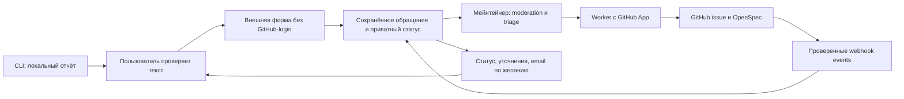

# Design

## Context

См. `proposal.md` для мотивации и evidence 2026-10-11. Актуальная `dev` (`5d236a0`) содержит bootstrap `bin/console`, Symfony Console 8, PHP 8.4/8.5, Docker/Make и изоляцию worktree. В `src/` ещё нет прикладных команд. Task runtime и общий формат ошибок находятся в PR #11; issue #12 развивает их диагностику. Внешний сервер/форма/почтовый канал отсутствуют.

Текущий путь: пользователь вручную открывает GitHub → login → описание issue; нет receipt, автоматической диагностики или обратного канала для человека без аккаунта. Требования нового поведения принадлежат `user-feedback`; существующие specs среды не изменяются.

## Goals / Non-Goals

**Goals:** HTTP-граница между локальным CLI и внешним приёмом; явное действие пользователя перед передачей; контролируемая публичная публикация; независимая работа статусной страницы без GitHub-login; сохранение контакта вне GitHub.

**Non-Goals:** телеметрия при каждой ошибке, загрузка полных логов/REST payload, OAuth GitHub для отправителя, создание issues в произвольных репозиториях, передача данных портала, Telegram как обязательный канал. Полноценный helpdesk и обещание SLA не входят в первую итерацию.

## Decisions

### 1. Внешняя форма с GitHub App, запуск с moderation

| Альтернатива | Польза | Ограничение |
| --- | --- | --- |
| GitHub Form / `gh issue create` | Минимум нашей инфраструктуры | Требует аккаунт отправителя; только дополнительный путь |
| Форма/email и ручной перенос | Подходит для пилота и резервного канала | Ручная трассировка/уведомления; не конечная автоматизация |
| Внешняя форма, очередь, App | Не требует GitHub у отправителя, поддерживает статус и controlled publication | Нужны хостинг, хранение, moderation и обслуживание |

Выбран третий вариант с проверкой текста мейнтейнером перед публикацией. Доступ администратора обязателен для triage; отсутствие регистрации относится к отправителю. Форма и worker образуют отдельный deployable сервис в `feedback-service/` этого репозитория; provider adapters отделены от receipt/publication контракта. Конкретные хостинг, durable storage и email transport фиксируются перед apply без изменения требований/порядка задач.

CLI владеет подготовкой отчёта; внешний сервис — private receipt/contact, очередью, moderation и уведомлениями; GitHub — публичным issue; мейнтейнер — категорией, milestone, OpenSpec и подтверждением релиза.

### 2. Локальная подготовка, передача через форму

`b24cli feedback` создаёт report из allowlist окружения и печатает форму/путь к файлу; `--open` явно открывает браузер. Ошибка открытия оставляет инструкции. Команда не обращается к порталу и не отправляет отчёт. Запуск работает через текущий Docker/Make entrypoint и будущий standalone; browser opening в контейнере не считается гарантированным, URL/file обеспечивают headless путь.

Форма позволяет писать сообщение вручную и опционально приложить структурированный отчёт с ограничением размера. Freeform text пользователь проверяет отдельно: allowlist diagnostics не гарантирует отсутствие секретов, которые пользователь сам вписал в описание. Moderation проверяет публикационную версию. Email не попадает в публикуемый body. Не передавать diagnostic body и контакт в query parameters или prefill URL.

Feedback hints добавляются в handler из PR #11/#12 только после появления его базы в dev. Для JSON/plain/quiet/non-TTY подсказка подавляется; человеческий TTY получает краткий stderr hint. Команда feedback не меняет контракт остальных команд.

### 3. Receipt, приватный доступ и управляемая публикация

Durable запись: `receiptId`, submission idempotency key, редактируемый publication body, `publicationConsent`, состояние, moderation decision, issue reference, уведомления. Контакт и секрет доступа хранятся отдельно от publication body. Статусная ссылка использует криптографически случайный bearer secret; сервер хранит его hash, исключает секрет из access logs/referrers/analytics, не грузит сторонние ресурсы на статусной странице. Она позволяет читать статус, отвечать на уточнения и удалить контакт.

Публичная форма принимает только закреплённую схему с ограничениями размера/частоты и антиспамом. Клиент не может задать целевой repo или произвольные параметры GitHub. Для браузерных запросов предусмотрены origin/CSRF checks; эскалация антиспама не требует GitHub-registration. Сохранение записи и enqueue выполняются атомарно либо через durable outbox до ответа «принято».

Publication состояния: `received` → `awaiting-review` → `publishing` → `linked`; дополнительные `rejected`, `duplicate-linked`, `publication-unknown`. Issue lifecycle/status и release information хранятся отдельно: закрытие не удаляет receipt и не означает выход релиза.

Worker публикует только одобренный текст. App установлена на один repo, `Issues: write` и обязательные metadata permissions; private key и installation tokens хранятся в server secrets. Установка обновляет token автоматически до истечения срока. Fine-grained PAT мейнтейнера допустим только как временный ручной пилот, не как ключ, распространяемый в CLI.

GitHub create issue API не обещает нашу идемпотентность. В body добавляется безопасный receipt marker; durable claim исключает одновременную публикацию. После timeout worker проверяет уже созданные App issues на marker. Если нельзя достоверно установить результат, оставляет `publication-unknown` для проверки; не повторяет POST вслепую. Повтор submission с тем же idempotency key возвращает receipt; похожие сообщения разных пользователей связываются после triage, а не удаляются автоматически.

Для каждого опубликованного issue мейнтейнер сохраняет двустороннюю ссылку на существующий/новый OpenSpec change, выбирает milestone и существующую категорию. Duplicates связываются с каноническим issue/change. Шаблон внешней публикации содержит triage checklist; worker не генерирует выдуманный change path.

### 4. Обратный ответ и подтверждённый релиз

App подписывается только на необходимые `issues`/`issue_comment` события. Ingress проверяет signature, repo и event/action; receipt updates и outbox notifications учитывают delivery ID и deduplication key. Внешний текст GitHub comment рассматривается как текст, не инструкция для сервера; email, приватные ответы и access secrets не копируются в публичные комментарии. Пользовательские уточнения публикуются после отдельной проверки.

Статус показывает события triage, запросы уточнений и resolution. Email используется при явном выборе и проверке владения адресом; без него статус полноценно работает. Confirmation, resolution и release email идут через outbox с дедупликацией. Удаление контакта отменяет ожидающие и будущие отправки. Мейнтейнер отдельно указывает подтверждённую версию/URL релиза; закрытие issue до релиза показывает ожидание.

### 5. Постепенный запуск и документация

Сначала форма с private receipt/status и ручной moderation; затем worker App и обратные events/email. Пилот с ручным созданием допускается для проверки UX, но окончательная приёмка требует App. README содержит основной URL и резервный support email, выбранные до запуска. `contact_links` добавляется вместе с GitHub bug form; доступность GitHub шаблонов зависит от merge в default branch, отдельно от PR в dev.

## Risks / Trade-offs

- Публичный endpoint привлекает спам → rate/size limits, антиспам, moderation, фиксированный target repo и наблюдение очереди.
- Пользователь вручную вставит приватные сведения → редактор, явное согласие, review публикационного текста; diagnostics используют allowlist.
- Потерянный ответ GitHub приводит к дублям → durable claim/marker reconciliation и `publication-unknown` без слепого POST.
- Ошибка webhooks/email задерживает ответ → durable outbox, дедупликация, retry/reconciliation; статус доступен независимо от почты.
- Приватная ссылка является bearer access → hash at rest, защита от log/referrer leakage, возможность отзыва; её потеря не обещает автоматическое восстановление личности.
- Нет email → push notification невозможна; отправитель проверяет статус по сохранённой ссылке.
- Task handler отсутствует в dev → независимую feedback-команду можно готовить первой, hints интегрировать после PR #11/#12 с проверкой совместимости.

## Migration Plan

1. Назначить владельца triage, основной/резервный URL, hosting/storage/email и срок хранения; подготовить deployable сервис и server secrets.
2. Проверить приём/status, moderation и недоступность GitHub на test deployment; установить App с минимальными правами.
3. Проверить создание, неизвестный результат POST, duplicates, webhooks, уточнения, contact deletion и release/email на тестовых обращениях без аккаунта отправителя.
4. Опубликовать CLI/help/README и внешний канал после end-to-end приёмки; отдельно выпустить GitHub шаблоны в main через обычный release flow.
5. При rollback выключить публикацию worker/hints и перевести основной URL на резервный канал; сохранять принятые receipts/outbox для обработки. Удаление существующих issues или контактов rollback не подразумевает.

## Open Questions

- Точный URL/support email, инфраструктурный provider, владелец triage и срок хранения выбираются перед запуском; не меняют интерфейс receipt/publication/status.
- Готовность PR #11/#12 и standalone #14 сверяется перед интеграцией; проверка ещё не выпущенного формата установки остаётся условной до его появления.

## Sources

- [Issue API](https://docs.github.com/en/rest/issues/issues#create-an-issue): installation token с `Issues: write`.
- [Authentication as installation](https://docs.github.com/en/apps/creating-github-apps/authenticating-with-a-github-app/authenticating-as-a-github-app-installation): App attribution и token lifecycle.
- [Webhook practices](https://docs.github.com/en/webhooks/using-webhooks/best-practices-for-using-webhooks): secret, HTTPS, delivery ID и async handling.
- [Template chooser](https://docs.github.com/en/communities/using-templates-to-encourage-useful-issues-and-pull-requests/configuring-issue-templates-for-your-repository#configuring-the-template-chooser): external `contact_links`, шаблоны после merge в default branch.

Документация проверена 2026-10-11; live App и delivery proof пока отсутствуют.
