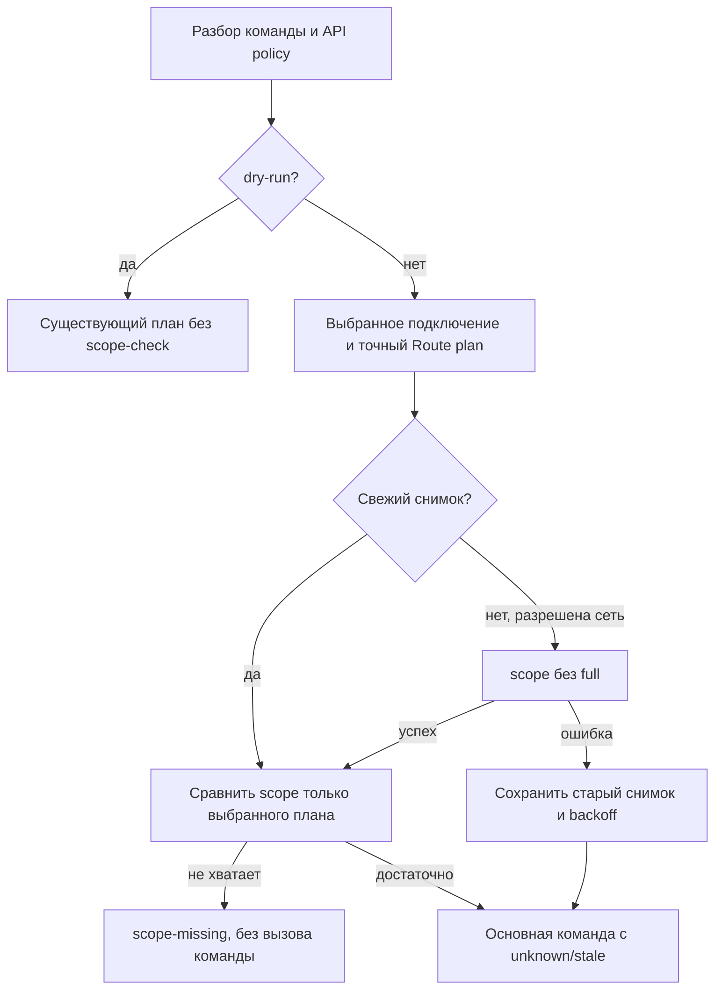

# Design

## Context

См. proposal.md. CommandRunner получает выбранный request и точный план Route до prepare (который иногда читает REST). ApiPolicyGuard отклоняет запрещённый план до credentials. ConnectionManager выбирает profile/env/file; ApiTransport заменяется в unit-тестах, production использует SdkApiTransport. ProfileRepository строго валидирует config v1 и публикует изменения атомарно под lock. FileProtection защищает Unix modes/Windows ACL и запрещает symlinks.

## Goals / Non-Goals

Проверять выбранный план до его первого REST-вызова и сохранять подтверждённые результаты независимо от config.json. Не повторять операции, не менять scope на портале, не считать кеш доказательством объектных прав.

## Decisions

1. Production ApiTransport становится декоратором SDK transport с отдельным интерфейсом command preflight. CommandRunner вызывает preflight после локального parsing/policy и до prepare. Тестовые замены ApiTransport сохраняют свой контракт; новые end-to-end тесты используют production-декоратор и MockHttpClient. Gateway проверки вызывает внутренний SDK transport для `scope` с пустыми parameters, исключая рекурсию.
2. ScopeManifest содержит явные требования всех поддержанных пар method/version; фактический план определяет требования режима команды. Каждая группа означает «хотя бы один scope». User методы допускают user/user_basic/user_brief без обещания всех полей. Неизвестный маршрут даёт configuration-error. Ревизия — SHA256 нормализованного манифеста, включая маршруты каталога; app version хранится отдельно. Новые команды/методы покрываются проверкой полноты.
3. Справочник scope рекомендует `task`; страницы REST3 пишут `tasks`, который справочник называет устаревшим. Для task-группы отсутствие обоих является подтверждённой нехваткой; наличие любого не блокируется. Значения granted не переименовываются. Рекомендуемое разрешение для настройки — `task`. Это консервативная проверка, не утверждение эквивалентности прав.
4. `state.json` version=1 хранит connections map. Ключ — SHA256 от выбранного source/profile/path и полного нормализованного webhook; таким образом ротация credentials, другой alias/source/config-dir не наследуют старую проверку. Сами URL/token/user ID не сохраняются. Запись содержит grantedScopes, lastSuccessfulCheckAt, checkedWithAppVersion, scopeManifestRevision, lastAttemptAt, nextCheckAt и status. Даты — UTC ISO8601; TTL=86400, backoff=300 секунд. После неудачи старый успешный снимок остаётся, status stale/unknown не позволяет новую блокировку до успешной проверки.
5. Отдельный `.state.lock`, private storage, ограниченный размер и атомарная rename защищают snapshot; lock держится во время scope request, чтобы конкурентные процессы не повторяли проверку. Callback читает актуальный state под lock и публикует только изменённые данные. Неверный/небезопасный state не перезаписывается: auto-check сообщает unknown и сохраняет обычное выполнение; ручная диагностика сообщает ошибку. При недоступной записи новый снимок не объявляется persisted.
6. Свежесть требует совпадения credentials/revision и возраста строго меньше суток. Patch update без изменения manifest не вызывает сеть. Первое использование, новый manifest, смена credentials, TTL и ручная проверка обновляют снимок. Неудача получает backoff независимо от manifest. Manual check игнорирует TTL/backoff и показывает granted, missing и потенциально затронутые команды (union каталога, зависимость от опций обозначена).
7. Fresh confirmed missing блокирует только текущий план до prepare с scope-missing/exit4. Успешная проверка с пустым result — подтверждённый пустой набор; неверный result не равен пустому. Unknown/stale продолжает основную команду с metadata/warning. Scope grant не подавляет обычный permission-denied API. Только точный insufficient_scope инвалидирует снимок для следующей команды; мутация не повторяется.
8. Dry-run, help, version, list, completion и существующие локальные команды не читают/пишут state и не добавляют scope request. Политика strict-rest3 сохраняется: auto-check использует лишь свежий кеш без REST1; при необходимости refresh возвращает unknown. Явный connection:check планирует REST1 scope и отклоняется strict-rest3 до credentials. Стандартная task-v3 проверяет автоматически.

## Risks / Trade-offs

- Изменение прав на портале внутри суток → известное окно кеша; connection:check обновляет немедленно.
- Документация task/tasks противоречива → консервативная группа и точная фиксация источников; live portal acceptance отдельно от fixtures.
- Scope request задерживает первую команду и держит lock → existing timeout ограничивает запрос; последующие вызовы используют кеш/backoff.
- Непригодное/readonly state storage → unknown, основной API сохраняет прежний результат; явная проверка сообщает ограничение.
- Dry-run с существующим remote schema/binding preflight сохраняет такой preflight, но новая scope-проверка не добавляется.

## Migration Plan

Config/credentials не мигрируют. State создаётся лениво, удаление state безопасно и требует повторной проверки. При откате старый CLI не читает отдельный state.

## Sources and evidence boundaries

Официальный bitrix24_dev MCP проверен 2026-10-15 через effective config и search/details. Это проверка документации, не вызов портала.

- https://apidocs.bitrix24.ru/api-reference/common/system/scope.html — `scope`, result string[], `full` отсутствует.
- https://apidocs.bitrix24.ru/api-reference/scopes/permissions.html — task, department, disk, im, варианты user; tasks устаревший.
- https://apidocs.bitrix24.ru/api-reference/tasks/tasks-task-get-rest-v3.html — scope tasks (расхождение со справочником).
- https://apidocs.bitrix24.ru/api-reference/tasks/tasks-task-get.html — REST1 scope task.
- https://apidocs.bitrix24.ru/api-reference/tasks/elapsed-item/task-elapsed-item-get-list.html и https://apidocs.bitrix24.ru/api-reference/tasks/checklist-item/task-checklist-item-get-list.html — scope task.
- https://apidocs.bitrix24.ru/api-reference/tasks/tasks-task-chat-message-send.html и https://apidocs.bitrix24.ru/api-reference/tasks/rest-v3/result/tasks-task-result-list.html — scope tasks.
- https://apidocs.bitrix24.ru/api-reference/chats/messages/im-dialog-messages-get.html, https://apidocs.bitrix24.ru/api-reference/chats/messages/im-message-update.html, https://apidocs.bitrix24.ru/api-reference/chats/messages/im-message-delete.html — scope im.
- https://apidocs.bitrix24.ru/api-reference/disk/folder/disk-folder-upload-file.html — scope disk.
- https://apidocs.bitrix24.ru/api-reference/user/user-get.html, https://apidocs.bitrix24.ru/api-reference/user/user-current.html — user/user_basic/user_brief.
- https://apidocs.bitrix24.ru/api-reference/departments/department-get.html — department.
