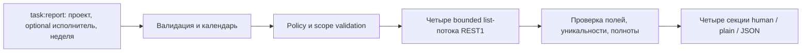

# Design

## Context

Мотивация и область — в [proposal.md](proposal.md). База `dev`: `0caf9db62fce3f91852aafc77fd9b25cb3f9bde2`. Сейчас 24 JTBD, 49 task-команд и 63 публичных команды; `task:report` не зарегистрирована. PM-09 станет 25-м JTBD (9 PM / 7 AM / 9 EMP), а новая команда после реализации — 50-й task / 64-й публичной.

Исследованы `ListTaskCommand`, `FindTaskCommand`, `ListTasksHandler`, `TaskListScanner`, `DeadlineWindowResolver`, `TaskStatus`, `Rest1TaskListAdapter`, `DeadlineTaskGateway`, `LegacyTaskFields`, `task-deadline-windows`, `task-workflows` и `task-mvp-scope`. Существующий scanner ограничивает обход, но возвращает один список и использует resolver дедлайнов; report имеет четыре секции и другую семантику дат. Существующий adapter уже читает классический list и переводит `createdDate/closedDate` в внутренние поля `created/closed`; это не имена полей нового API payload.

## Goals / Non-Goals

**Goals:** вынести недельный календарь, чтение и агрегацию в отдельно проверяемые компоненты, сохранить единый CommandRunner, API policy, scope validation, cancellation и общие форматы. Отчёт всегда относится к выбранному проекту; optional responsible только сужает его.

**Non-Goals:** история всех закрытий, восстановление состава проекта/ответственных/статусов на конец недели, организационные отделы, автоматическая рассылка, расписание, CSV/XLSX/PDF, трудозатраты, задачи удалённые или скрытые от подключения, запись в портал. Этот planning-этап не реализует команду.

## Decisions

### 1. Публичный вход

```sh
# Весь выбранный проект за прошлую календарную неделю
b24cli task:report --group-id 234 --timezone Asia/Bishkek
# Те же показатели для одного текущего ответственного внутри проекта
b24cli task:report --group-id 234 --responsible 14 --week 2026-10-12 --timezone Asia/Bishkek --json
```

`--group-id` обязателен; `--responsible` необязателен и не берётся из default.task. `--week` принимает this-week, last-week или корректную ISO date, по умолчанию last-week. ISO date выбирает содержащую её неделю, понедельник не обязателен. `--timezone` использует существующий порядок IANA → TZ → PHP и всегда выводится. `--max-scan` — положительное целое, default 10000, общий для четырёх секций. Повтор одиночных флагов, неизвестные аргументы и будущая неделя — usage-error до credentials/API. Не добавлять `--where`, `--status`, `--limit`, `--all` и дополнительные временные режимы.

Это сохраняет привычные имена проекта/ответственного. Отдельный `--week` нужен, поскольку существующий `--deadline-window` означает дедлайн, а не создание/закрытие. Смежный [#141](https://github.com/mesilov/bitrix24-cli/issues/141) не является блокирующей зависимостью; если к apply появился общий календарный resolver, использовать его с теми же проверенными границами без расширения scope #141.

### 2. Календарь и текущие наблюдения

Отдельный `ReportWeekResolver` использует существующий `Clock`; не расширять deadline-specific `DeadlineWindow` флагами отчёта. `reportAt` фиксируется до первого запроса; from/to вычисляются календарно в выбранной IANA zone, effectiveTo=min(to,reportAt). Даты с offset передаются API без потери timezone. Не вычитать фиксированные 7*86400 секунд.

Closed/new применяют [from,effectiveTo); контроль и in_progress описывают наблюдаемые текущие статусы. `observedUntil` фиксируется после чтения. Диапазон наблюдения и `snapshotAtomic=false` явно показывают, что REST list не даёт транзакционного снимка. Для прошлой недели эти текущие секции также относятся к сегодняшнему чтению. Проект и ответственный проверяются в текущих данных. Все даты не означают историческое закрепление задачи за человеком.

Альтернатива: полная история каждой задачи для as-of snapshot. Она требует другой доказуемой полноты, дополнительных вызовов и не нужна для согласованных четырёх показателей.

### 3. Заранее выбранный REST1 list

Эффект команды — read. Единственный метод данных отчёта: `tasks.task.list`, version 1, scope `task`. Никаких lifecycle, user lookups, group membership calls или REST3 hydration. Существующая инфраструктурная scope validation может выполнять свои штатные служебные запросы; route отчёта объявляется заранее. Strict-rest3 отклоняет план до загрузки credentials/API.

REST1 выбран по подтверждённым документированным server filters создания/завершения, логического статуса и проекта. Альтернативу REST3 с предположенными полями/операторами не использовать как fallback. Допуск этого метода не разрешает произвольные REST1 операции.

| Назначение | Нативный REST1 request | Ответ / преобразование на границе |
| --- | --- | --- |
| Проект | GROUP_ID, positive integer | groupId; числовую строку нормализовать в positive int |
| Ответственный | RESPONSIBLE_ID, positive integer при флаге | responsibleId → positive int |
| Логический статус | REAL_STATUS в filter | status: 3/4/5 → in_progress/supposedly_completed/completed |
| Создание | CREATED_DATE в select и >= / < фильтрах | createdDate: ISO8601 string |
| Завершение | CLOSED_DATE в select и >= / < фильтрах | closedDate: ISO8601 string либо null |
| Идентификатор/название | ID / TITLE в select | id → positive int, title → string |
| Навигация/порядок | start, order {ID: asc}; страница 50 | result.tasks, next; total не заменяет обход |

Request-имена сохраняют регистр; `created`, `closed`, `creatorId`, `groupId` не отправляются вместо нативных REST1 ключей. Output списка использует нативные response dates `createdDate/closedDate` и существующие CLI logical statuses; служебные контейнеры отчёта не являются API fields. Доступность записи полей не нужна: команда ничего не записывает.

### 4. Четыре выборки с общим бюджетом

Общая область S = GROUP_ID + optional RESPONSIBLE_ID. В фиксированном порядке выполняются четыре bounded list-потока, без вызова дочерних CLI-команд:

| Секция | Серверный filter сверх S | Результат |
| --- | --- | --- |
| closedTasks | REAL_STATUS=5, >=CLOSED_DATE=from, <CLOSED_DATE=effectiveTo | список и точный count при полноте |
| awaitingControlTasks | REAL_STATUS=4 | текущий список и count |
| newTasks | >=CREATED_DATE=from, <CREATED_DATE=effectiveTo | count независимо от текущего статуса |
| inProgressTasks | REAL_STATUS=3 | текущий count |

Закрытая задача выбирается по текущему completed и последнему доступному closedDate. Повторно открытая не входит. Повторные завершения не считаются отдельными событиями. ClosedDate и createdDate проверяются локально по тому же интервалу, scope и status также сверяются по ответу. Одна задача может быть new и closed; контроль/работа/закрыто — взаимоисключающие текущие статусы.

Server filters уменьшают чтение больших проектов. Альтернатива — один scan всей истории проекта с локальной агрегацией — легче исчерпывает бюджет старыми задачами. Четыре потока не являются атомарным снимком: противоречащие наблюдения одного ID в текущих статусах помечают затронутые секции partial. Наблюдаемая ошибка не исправляется выбором «удобной» версии строки.

`max-scan` считает обработанные строки всех потоков, включая дубликаты. Каждая секция хранит seen IDs; одинаковый duplicate не увеличивает count. Число запросов также ограничивается продвижением next и бюджетом. Повтор next, циклы, пустая страница с продолжением, конфликт данных, превышение бюджета или отсутствующие predicate fields дают partial. При окончании последней страницы всех потоков ровно на бюджете результат полный; если остаётся продолжение либо ещё не пройденная секция, полнота не доказана. Нет автоматического повторного сканирования при гонках.

Первый API отказ до получения данных возвращает штатную ошибку. Ошибка после накопления данных сохраняет подтверждённые результаты и partial/exit 3; явный access denied не превращается в нулевой отчёт. Cancellation сохраняет штатный exit 130. Успешный полный ноль относится только к доступной подключению выборке, не ко всем скрытым задачам портала.

### 5. Прикладной шов и форматы

Новый request → handler → `WeeklyReportTaskGateway` → REST1 adapter отделяет отчёт от консольного ввода и транспорта. Реализация adapter может выделить общий read-only list primitive из `Rest1TaskListAdapter`; не расширять публичный `DeadlineTaskGateway` произвольными датами только ради report. Existing mapping не копировать в несколько несогласованных таблиц. Детерминированный aggregator получает нормализованные строки и календарь; прямые unit-тесты используют fake gateway и фиксированный Clock.



JSON сохраняет envelope `data/meta/error`. В `data` ровно четыре секции: closedTasks/awaitingControlTasks содержат items, count, observedCount, complete, reasons; newTasks/inProgressTasks — count, observedCount, complete, reasons без лишних списков. `count` = точное целое только при complete=true, иначе null; observedCount = число уникальных подтверждённых совпадений. Непрочитанные секции имеют items=[] при списке, observedCount=0, count=null, complete=false, причину not-scanned. `meta` содержит reportAt, observedUntil, period (from,to,effectiveTo,timezone,unfinished), scope (groupId,responsibleId,visibility=accessible), apiVersion, snapshotAtomic=false, scanned, maxScan, complete и причины.

Human печатает четыре подписанных блока, период, текущий характер контроля/работы и partial рядом с показателем. Plain — TSV columns `section,recordType,id,title,responsibleId,groupId,status,createdDate,closedDate,count,observedCount,complete,reason`; task-строки только для двух списков, summary-строка для каждой из четырёх секций. Null count печатается `null`, а не пустым полем/нулём; tabs/newlines экранируются по существующим правилам. Header и metadata-сводка в stderr соответствуют общим правилам plain. Списки не обрезаются скрытым output-limit; ограничение только через явный scan budget и partial.

## Risks / Trade-offs

- [Отчёт за прошлую неделю можно принять за исторический snapshot] → явные подписи текущих секций и reportAt/observedUntil; никаких as-of обещаний.
- [Изменение задач во время четырёх потоков] → snapshotAtomic=false, фиксированный период, поиск конфликтов наблюдений и partial; отсутствие замеченного конфликта не доказывает атомарность.
- [Права скрывают задачи или удаление убирает их из истории] → visibility=accessible; не обещать аудит всех действий за неделю.
- [Большой проект исчерпывает бюджет] → серверные filters, общий конечный max-scan, per-section completeness и неизвестные точные числа.
- [REST1 STATUS содержит мета-статусы] → фильтровать по REAL_STATUS, читать и проверять response status.
- [Смежный #141 меняет resolver/adapter] → при apply синхронизировать актуальную dev и проверить затронутый календарный контракт; не расширять этот change общим назначением сроков.
- [Трассировка и runtime меняются отдельно] → issue #168 связывает planning MR и последующую реализацию; merge одного плана не закрывает issue и не означает готовность команды.

## Validation and delivery

План тестирования: границы/DST/смена года, четыре набора, текущий scope, null и неверные даты, повторные открытия, отсутствие скрытого user default, native REST1 filters, >=51 строк, общий бюджет и точная граница, conflicting duplicates, page/access errors, strict policy, scope, cancellation и три формата. Обновить реальные integration class и каталоги только при реализации; тестовые файлы и planning сами не доказывают live-приёмку.

Сейчас публикуется только план и PM-09 «План»; main specs синхронизируются при завершении change, а не заранее. После реализации — verify, CI и разрешённая portal-приёмка с очисткой owned fixtures, MR в dev. Архивирование и удаление worktree выполняются после завершения реализации/проверок и merge; planning-change не архивируется.

## Sources and verification boundary

- `codex mcp get bitrix24_dev --json` в worktree: enabled=true, transport streamable_http, endpoint `https://mcp-dev.bitrix24.tech/mcp`.
- 16.10.2026 выполнены реальные `bitrix-search` → `bitrix-method-details` для `tasks.task.list`, `tasks.task.field.list`. Индекс method-details list указывает REST3 и смешивает описания навигации; он не используется как доказательство REST1 payload.
- Для выбранной версии отдельно сверены [классический list](https://apidocs.bitrix24.ru/api-reference/tasks/tasks-task-list.html) и [классические поля](https://apidocs.bitrix24.ru/api-reference/tasks/fields.html): REAL_STATUS и его отличие от STATUS, даты создания/завершения, GROUP_ID/RESPONSIBLE_ID, native response dates и start.
- Изучение документации подтверждает контракт постановки. Portal payload, права конкретного подключения, полнота живой навигации и поведение повторного открытия должны быть проверены при apply; live-запросов и записей этот этап не выполнял.
